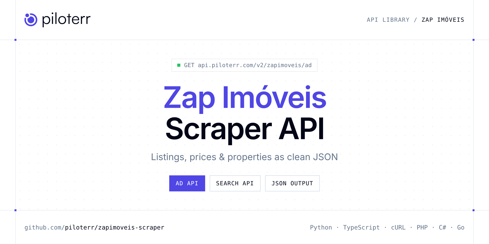

<p align="center">
  <a href="https://www.piloterr.com"></a>
</p>

# Zap Imóveis Scraper API

[](https://discord.gg/CFj3ph8aHU) [](https://app.piloterr.com) [](https://app.piloterr.com/openapi) [](LICENSE)

The **Piloterr Zap Imóveis Scraper API** lets you extract public data from Zap Imóveis as **clean, structured JSON** — no proxies, headless browsers or HTML parsing to maintain. Endpoints available in production:

- **Zap Imóveis Ad API** — Get a full Zap Imóveis listing by URL: price, IPTU, features, coordinates, images, and publisher (1 credit).
- **Zap Imóveis Search API** — Search Zap Imóveis listings by city or search URL.

Use it for property price monitoring, market analytics, investment sourcing or rental yield models.

| Endpoint | Path | Credits | What you get |
|---|---|---|---|
| [Zap Imóveis Ad API](#zap-imóveis-ad-api) | `/v2/zapimoveis/ad` | 1 | Get a full Zap Imóveis listing by URL |
| [Zap Imóveis Search API](#zap-imóveis-search-api) | `/v2/zapimoveis/search` | 1 | Search Zap Imóveis listings by city or search URL. Returns prices, IPTU, condominium fees, rooms, and pagination (1 credit). |

## Table of contents

- [How it works](#how-it-works)
- [Zap Imóveis Ad API](#zap-imóveis-ad-api)
- [Zap Imóveis Search API](#zap-imóveis-search-api)
- [Code examples in other languages](#code-examples-in-other-languages)
- [Practical use cases](#practical-use-cases)
- [Why Piloterr?](#why-piloterr)
- [FAQ](#faq)
- [Official SDKs](#official-sdks)
- [Related scrapers](#related-scrapers)
- [Support](#support)

## How it works

1. **Create a free Piloterr account** and copy your API key from the [dashboard](https://app.piloterr.com).
2. **Send a `GET` (or `POST`) request** to `https://api.piloterr.com/v2/...` with the header `x-api-key: YOUR_API_KEY`.
3. **Receive structured JSON** — Piloterr handles rendering, proxies, retries and parsing.

```bash
export PILOTERR_API_KEY="your-api-key"
pip install requests        # Python
# TypeScript: Node.js 18+ (native fetch), run with `npx tsx file.ts`
```

> Every endpoint accepts both `GET` (query string) and `POST` (JSON body with the same fields).

## Zap Imóveis Ad API

Get a full Zap Imóveis listing by URL: price, IPTU, features, coordinates, images, and publisher (1 credit).

`GET | POST https://api.piloterr.com/v2/zapimoveis/ad` · **1 credit per request** · [Full reference](https://app.piloterr.com/openapi)

### Request parameters

| Parameter | Type | Required | Description |
|---|---|---|---|
| `query` | string | ✅ | Full Zap Imóveis listing URL. Accepts `/imovel/` and `/lancamentos/`. |

### Python example

```python
import json
import os
import requests

response = requests.get(
    "https://api.piloterr.com/v2/zapimoveis/ad",
    headers={"x-api-key": os.environ["PILOTERR_API_KEY"]},
    params={
        "query": "https://www.zapimoveis.com.br/imovel/venda-apartamento-3-quartos-mobiliado-jardim-paulista-zona-sul-sao-paulo-sp-170m2-id-2912096343/",
    },
    timeout=120,
)
response.raise_for_status()
data = response.json()

print(json.dumps(data, indent=2, ensure_ascii=False)[:2000])
```

### TypeScript example

```typescript
type ZapImveisAd = {
  id?: string;
  url?: string;
  price?: {
    iptu?: number;
    amount?: number;
    currency?: string;
    price_max?: unknown;
    condominium?: number;
    price_per_m2?: number;
    price_period?: unknown;
  };
  title?: string;
  images?: string[];
  status?: string;
  features?: {
    floor?: number;
    suites?: number;
    area_m2?: number;
    area_max?: unknown;
    bedrooms?: number;
    amenities?: string[];
    bathrooms?: number;
    parking_spaces?: number;
    building_floors?: number;
  };
  location?: {
    city?: string;
    state?: string;
    street?: string;
    latitude?: number;
    longitude?: number;
    state_code?: string;
    approximate?: boolean;
    full_address?: string;
    neighborhood?: string;
  };
  operation?: string;
  publisher?: {
    id?: string;
    url?: string;
    name?: string;
    tier?: string;
    phones?: string[];
    license?: string;
    logo_url?: string;
    verified?: boolean;
    whatsapp?: string;
  };
  reference?: string;
  updated_at?: string;
  description?: string;
  published_at?: string;
  property_type?: string;
  thumbnail_url?: string;
  virtual_tour_url?: unknown;
};

const params = new URLSearchParams({
  "query": "https://www.zapimoveis.com.br/imovel/venda-apartamento-3-quartos-mobiliado-jardim-paulista-zona-sul-sao-paulo-sp-170m2-id-2912096343/",
});

const response = await fetch(`https://api.piloterr.com/v2/zapimoveis/ad?${params}`, {
  headers: { "x-api-key": process.env.PILOTERR_API_KEY! },
});
if (!response.ok) throw new Error(`Piloterr error ${response.status}: ${await response.text()}`);

const data = (await response.json()) as ZapImveisAd;

console.log(JSON.stringify(data, null, 2).slice(0, 2000));
```

<details>
<summary><b>POST variant</b></summary>

```http
POST https://api.piloterr.com/v2/zapimoveis/ad
x-api-key: YOUR_API_KEY
Content-Type: application/json

{"query": "https://www.zapimoveis.com.br/imovel/venda-apartamento-3-quartos-mobiliado-jardim-paulista-zona-sul-sao-paulo-sp-170m2-id-2912096343/"}
```
</details>

### Output example

Example response from the API reference, abridged — real values depend on the page you scrape.

```json
{
  "id": "2912096343",
  "url": "https://www.zapimoveis.com.br/imovel/venda-apartamento-3-quartos-mobiliado-jardim-paulista-zona-sul-sao-paulo-sp-170m2-id-2912096343/",
  "price": {
    "iptu": 800,
    "amount": 2500000,
    "currency": "BRL",
    "price_max": null,
    "condominium": 3300,
    "price_per_m2": 14706,
    "price_period": null
  },
  "title": "Apartamento para comprar com 170 m², 3 quartos, 3 banheiros, 2 vagas",
  "images": [
    "https://resizedimgs.zapimoveis.com.br/img/vr-listing/ab361b6c58c7374a2d3ddb8893e24c4f/apartamento-com-3-quartos-a-venda-170m-no-jardim-pa…",
    "https://resizedimgs.zapimoveis.com.br/img/vr-listing/606ad8b94d41ff11d250bbf21f42fac1/apartamento-com-3-quartos-a-venda-170m-no-jardim-pa…"
  ],
  "status": "active",
  "features": {
    "floor": 9,
    "suites": 1,
    "area_m2": 170,
    "area_max": null,
    "bedrooms": 3,
    "amenities": [
      "reception",
      "furnished"
    ],
    "bathrooms": 3,
    "parking_spaces": 2,
    "building_floors": 10
  },
  "location": {
    "city": "São Paulo",
    "state": "São Paulo",
    "street": "Alameda Joaquim Eugênio de Lima",
    "latitude": -23.571,
    "longitude": -46.656,
    "state_code": "SP",
    "approximate": true,
    "full_address": "Alameda Joaquim Eugênio de Lima - Jardim Paulista, São Paulo - SP",
    "neighborhood": "Jardim Paulista"
  },
  "operation": "sale",
  "publisher": {
    "id": "f6645d26-414f-98df-22b0-338e40a3d71f",
    "url": "https://www.zapimoveis.com.br/imobiliaria/661812/",
    "name": "Paulo Roberto Leardi",
    "tier": "diamond",
    "phones": [
      "1132847000",
      "11973516994"
    ],
    "license": "13057-F-SP",
    "logo_url": "https://resizedimgs.zapimoveis.com.br/img/vr-listing/7ee8941c3572b44acc3d9a9ea4ce29e9/paulo-roberto-leardi.webp?action=fit-in&dimension=7…",
    "verified": false,
    "whatsapp": "11973516994"
  },
  "reference": "667523",
  "updated_at": "2026-10-01T11:33:22.061Z",
  "description": "Apartamento à venda no nobre e sofisticado bairro do Jardim Paulista entre a alameda Lorena e rua Guarará, parte plana, próximo ao lindo …",
  "published_at": "2021-06-04T20:57:05Z",
  "property_type": "apartment",
  "thumbnail_url": "https://resizedimgs.zapimoveis.com.br/img/vr-listing/ab361b6c58c7374a2d3ddb8893e24c4f/apartamento-com-3-quartos-a-venda-170m-no-jardim-pa…",
  "virtual_tour_url": null
}
```

### Response fields

| Field | Type | Description |
|---|---|---|
| `id` | string |  |
| `url` | string |  |
| `price` | object |  |
| `price.iptu` | integer |  |
| `price.amount` | integer |  |
| `price.currency` | string |  |
| `price.price_max` | object |  |
| `price.condominium` | integer |  |
| `price.price_per_m2` | integer |  |
| `price.price_period` | object |  |
| `title` | string |  |
| `images` | string[] |  |
| `status` | string |  |
| `features` | object |  |
| `features.floor` | integer |  |
| `features.suites` | integer |  |
| `features.area_m2` | integer |  |
| `features.area_max` | object |  |
| `features.bedrooms` | integer |  |
| `features.amenities` | string[] |  |
| `features.bathrooms` | integer |  |
| `features.parking_spaces` | integer |  |
| `features.building_floors` | integer |  |
| `location` | object |  |
| `location.city` | string |  |

## Zap Imóveis Search API

Search Zap Imóveis listings by city or search URL. Returns prices, IPTU, condominium fees, rooms, and pagination (1 credit).

`GET | POST https://api.piloterr.com/v2/zapimoveis/search` · **1 credit per request** · [Full reference](https://app.piloterr.com/openapi)

### Request parameters

| Parameter | Type | Required | Description |
|---|---|---|---|
| `query` | string | ✅ | City, `City, UF`, neighborhood, or full Zap Imóveis search URL. |
| `operation` | string | — | Transaction type. Used when `query` is a city. Ignored as a path builder when `query` is a full URL. |
| `property_type` | string | — | Property type. Used when `query` is a city. |
| `page` | number | — | Page number (1-based). Default: `1`. Values above 1 set `pagina` on the URL. |
| `min_price` | number | — | Minimum asking price in BRL. |
| `max_price` | number | — | Maximum asking price in BRL. |
| `min_area` | number | — | Minimum area in m². |
| `max_area` | number | — | Maximum area in m². |
| `min_bedrooms` | number | — | Minimum bedroom count. |
| `min_bathrooms` | number | — | Minimum bathroom count. |
| `min_parking` | number | — | Minimum parking spaces. |

### Python example

```python
import json
import os
import requests

response = requests.get(
    "https://api.piloterr.com/v2/zapimoveis/search",
    headers={"x-api-key": os.environ["PILOTERR_API_KEY"]},
    params={
        "query": "S\u00e3o Paulo",
    },
    timeout=120,
)
response.raise_for_status()
data = response.json()

print(json.dumps(data, indent=2, ensure_ascii=False)[:2000])
```

### TypeScript example

```typescript
type ZapImveisSearch = {
  results?: {
    id?: string;
    url?: string;
    city?: string;
    iptu?: number;
    floor?: number;
    price?: number;
    state?: string;
    title?: string;
    suites?: number;
    address?: string;
    area_m2?: number;
    area_max?: unknown;
    bedrooms?: number;
    currency?: string;
    latitude?: number;
    bathrooms?: number;
    longitude?: number;
    operation?: string;
    price_max?: unknown;
    state_code?: string;
    condominium?: number;
    neighborhood?: string;
    price_per_m2?: number;
    price_period?: unknown;
    published_at?: string;
    [key: string]: unknown;
  }[];
  pagination?: {
    next?: string;
    page?: number;
    per_page?: number;
    total_pages?: number;
    total_results?: number;
  };
};

const params = new URLSearchParams({
  "query": "S\u00e3o Paulo",
});

const response = await fetch(`https://api.piloterr.com/v2/zapimoveis/search?${params}`, {
  headers: { "x-api-key": process.env.PILOTERR_API_KEY! },
});
if (!response.ok) throw new Error(`Piloterr error ${response.status}: ${await response.text()}`);

const data = (await response.json()) as ZapImveisSearch;

console.log(JSON.stringify(data, null, 2).slice(0, 2000));
```

<details>
<summary><b>POST variant</b></summary>

```http
POST https://api.piloterr.com/v2/zapimoveis/search
x-api-key: YOUR_API_KEY
Content-Type: application/json

{"query": "São Paulo"}
```
</details>

### Output example

Example response from the API reference, abridged — real values depend on the page you scrape.

```json
{
  "results": [
    {
      "id": "2912096343",
      "url": "https://www.zapimoveis.com.br/imovel/venda-apartamento-3-quartos-mobiliado-jardim-paulista-zona-sul-sao-paulo-sp-170m2-id-2912096343/",
      "city": "São Paulo",
      "iptu": 800,
      "floor": 9,
      "price": 2500000,
      "state": "São Paulo",
      "title": "Apartamento para comprar com 170 m², 3 quartos, 3 banheiros, 2 vagas",
      "suites": 1,
      "address": "Alameda Joaquim Eugênio de Lima",
      "area_m2": 170,
      "area_max": null,
      "bedrooms": 3,
      "currency": "BRL",
      "latitude": -23.571,
      "bathrooms": 3,
      "longitude": -46.656,
      "operation": "sale",
      "price_max": null,
      "state_code": "SP",
      "condominium": 3300,
      "neighborhood": "Jardim Paulista",
      "price_per_m2": 14706,
      "price_period": null,
      "published_at": "2021-06-04T20:57:05Z"
    },
    {
      "id": "2856335837",
      "url": "https://www.zapimoveis.com.br/lancamentos/joya-jardins-id-2856335837/",
      "city": "São Paulo",
      "iptu": null,
      "floor": 0,
      "price": 1707192,
      "state": "São Paulo",
      "title": "Apartamento para comprar com 57 - 153 m², 1 quarto, 1 banheiro, 1 vaga",
      "suites": 1,
      "address": "Rua da Consolação",
      "area_m2": 57,
      "area_max": 153,
      "bedrooms": 1,
      "currency": "BRL",
      "latitude": -23.558224,
      "bathrooms": 1,
      "longitude": -46.665412,
      "operation": "sale",
      "price_max": 4740872,
      "state_code": "SP",
      "condominium": null,
      "neighborhood": "Cerqueira César",
      "price_per_m2": 29951,
      "price_period": null,
      "published_at": "2025-03-12T11:42:11Z"
    }
  ],
  "pagination": {
    "next": "https://www.zapimoveis.com.br/venda/apartamentos/sp+sao-paulo/?pagina=2",
    "page": 1,
    "per_page": 30,
    "total_pages": 14528,
    "total_results": 435826
  }
}
```

### Response fields

| Field | Type | Description |
|---|---|---|
| `results[]` | object[] |  |
| `results[].id` | string |  |
| `results[].url` | string |  |
| `results[].city` | string |  |
| `results[].iptu` | integer |  |
| `results[].floor` | integer |  |
| `results[].price` | integer |  |
| `results[].state` | string |  |
| `results[].title` | string |  |
| `results[].suites` | integer |  |
| `results[].address` | string |  |
| `results[].area_m2` | integer |  |
| `results[].area_max` | object |  |
| `results[].bedrooms` | integer |  |
| `results[].currency` | string |  |
| `results[].latitude` | number |  |
| `results[].bathrooms` | integer |  |
| `results[].longitude` | number |  |
| `results[].operation` | string |  |
| `results[].price_max` | object |  |
| `results[].state_code` | string |  |
| `results[].condominium` | integer |  |
| `results[].neighborhood` | string |  |
| `results[].price_per_m2` | integer |  |
| `results[].price_period` | object |  |

## Code examples in other languages

Ready-to-run examples live in the [`examples/`](examples) folder. Each one reads your key from the `PILOTERR_API_KEY` environment variable.

| Language | Ad | Search |
|---|---|---|
| cURL (Bash) | [`ad`](examples/curl/ad.sh) | [`search`](examples/curl/search.sh) |
| PHP | [`ad`](examples/php/ad.php) | [`search`](examples/php/search.php) |
| C# | [`ad`](examples/csharp/Ad.cs) | [`search`](examples/csharp/Search.cs) |
| Go | [`ad`](examples/go/ad.go) | [`search`](examples/go/search.go) |
| Java | [`ad`](examples/java/AdExample.java) | [`search`](examples/java/SearchExample.java) |
| Ruby | [`ad`](examples/ruby/ad.rb) | [`search`](examples/ruby/search.rb) |
| Node.js | [`ad`](examples/nodejs/ad.mjs) | [`search`](examples/nodejs/search.mjs) |

## Practical use cases

- **Price monitoring** — Track asking prices and price drops per area.
- **Market analytics** — Measure inventory, days on market and price per m² / sqft.
- **Investment sourcing** — Detect undervalued properties as soon as they are listed.
- **Rental yield models** — Combine sale and rent listings to estimate yields.
- **Proptech products** — Power portals, valuation tools and alerts with structured listings.

## Why Piloterr?

- **No infrastructure** — no proxies, headless browsers or CAPTCHA solving to run yourself.
- **Structured JSON** — stable, documented fields instead of brittle HTML selectors.
- **Pay per request** — transparent credit cost per endpoint, failed requests are retried for you.
- **One API key, hundreds of sources** — Zap Imóveis plus many other e-commerce, search and company data endpoints in the [Piloterr library](https://www.piloterr.com/library).
- **Any language** — plain HTTPS + JSON, with examples for Python, TypeScript, cURL, PHP, C#, Go, Java, Ruby and Node.js.

## FAQ

### Is it legal to scrape Zap Imóveis?

Collecting publicly available data is generally allowed in many jurisdictions, but rules depend on your country, the data you collect and how you use it. Avoid personal data unless you have a lawful basis, respect the website's terms where they apply, and get legal advice for your specific use case. This is not legal advice.

### Do I need proxies or a headless browser?

No. Piloterr handles rendering, proxy rotation and retries on its side. You only send an HTTPS request with your `x-api-key` header and receive JSON.

### How much does a request cost?

Credits per call: `/v2/zapimoveis/ad` **1**, `/v2/zapimoveis/search` **1**. See the [Piloterr website](https://www.piloterr.com) for plans.

### What data does the Zap Imóveis API return?

Each endpoint returns structured JSON: **Zap Imóveis Ad** — `id`, `url`, `price`, `price.iptu`, `price.amount`, `price.currency`; **Zap Imóveis Search** — `results[]`, `results[].id`, `results[].url`, `results[].city`, `results[].iptu`, `results[].floor`.

### How do I paginate Zap Imóveis results?

Use the `page` parameter and keep requesting while the response indicates more results.

### Which languages are supported?

Any language that can make an HTTP request. This README shows Python and TypeScript; the [`examples/`](examples) folder contains cURL, PHP, C#, Go, Java, Ruby and Node.js.

## Official SDKs

Use Piloterr from your own language with a typed client:

| SDK | Package | Install |
| --- | --- | --- |
| Node.js | [`@piloterr/sdk`](https://www.npmjs.com/package/@piloterr/sdk) | `npm install @piloterr/sdk` |
| Python | [`piloterr`](https://pypi.org/project/piloterr/) | `pip install piloterr` |
| Go | [`piloterr-go`](https://pkg.go.dev/github.com/piloterr/piloterr-go) | `go get github.com/piloterr/piloterr-go` |
| .NET | [`Piloterr`](https://www.nuget.org/packages/Piloterr) | `dotnet add package Piloterr` |
| Ruby | [`piloterr`](https://rubygems.org/gems/piloterr) | `gem install piloterr` |
| PHP | [`piloterr/sdk`](https://packagist.org/packages/piloterr/sdk) | `composer require piloterr/sdk` |
| Java | [`piloterr-java`](https://github.com/piloterr/piloterr-java) | build from source, see its README |
| CLI | [`@piloterr/cli`](https://www.npmjs.com/package/@piloterr/cli) | `npm install -g @piloterr/cli` |
| MCP server | [`@piloterr/mcp`](https://www.npmjs.com/package/@piloterr/mcp) | `npx -y @piloterr/mcp` |

## Related scrapers

- [Apartments Scraper API](https://github.com/piloterr/apartments-scraper)
- [Argenprop Scraper API](https://github.com/piloterr/argenprop-scraper)
- [Centris Scraper API](https://github.com/piloterr/centris-scraper)
- [Fotocasa Scraper API](https://github.com/piloterr/fotocasa-scraper)
- [Funda Scraper API](https://github.com/piloterr/funda-scraper)
- [Homestra Scraper API](https://github.com/piloterr/homestra-scraper)
- [All Piloterr scrapers on GitHub](https://github.com/piloterr)

## Support

- 💬 Join the [Piloterr Discord](https://discord.gg/CFj3ph8aHU) to ask questions and share what you build.
- 📚 Browse the [API reference (OpenAPI)](https://app.piloterr.com/openapi) and the [Piloterr library](https://www.piloterr.com/library).
- 🔑 [Get your API key](https://app.piloterr.com).

---

<p align="center">
  <a href="https://www.piloterr.com">
    <picture>
      <source media="(prefers-color-scheme: dark)" srcset="images/logo-dark.svg">
      
    </picture>
  </a>
  <br>
  <sub>Built by <a href="https://www.piloterr.com">Piloterr</a> — web scraping APIs for e-commerce, search, real estate and more, one API key.</sub>
</p>

<sub>Zap Imóveis is a trademark of its respective owner. This repository is not affiliated with or endorsed by Zap Imóveis. Examples are released under the MIT license.</sub>
